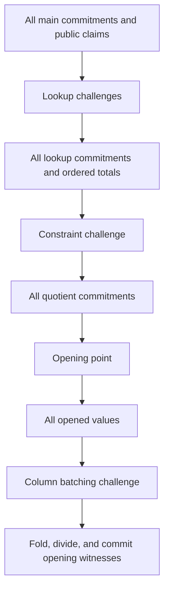

# KZG residency on one 96 GB GPU

Design review: 2026-10-13, `sb/kzg` at `1e2182f`. The target is the existing
recursive KZG verifier on one RTX PRO 6000 Blackwell with 96 GB VRAM and the
reviewer-reported 249 GiB host. This document proposes execution and storage
changes, with the existing proof protocol, circuit, degree policy, public
claims, and proof encoding preserved. No implementation, build, or benchmark
was run for this design.

## Capacity conclusion

**Keeping every current dense representation resident does not fit. Keeping
the recursive prover's useful state on the GPU appears feasible with compact
fixed inputs, in-place representation changes, and a different consumer
schedule.** A worked schedule below needs approximately **78.44 GiB plus
explicitly budgeted overhead** at its largest modeled phase, including the
full 12 GiB SRS. This is a capacity estimate, not a measured allocation peak
or a performance result. It uses the recorded v4 shape; authentic Filecoin
constants still require the separate circuit recount already documented for
that migration.

The important distinction is between retaining the information needed to
reconstruct a polynomial and retaining every expanded representation of it.
Fixed data can remain on the GPU in a compact, exact representation while
selected columns are expanded and transformed when needed. Witness buffers
can change between coefficients and evaluations without keeping both copies.

All calculations below use GiB and 32-byte BLS12-381 scalar elements. The
card's actual CUDA-reported byte capacity must determine admission; the
user's nominal 96 GB specification is not a measured free-memory budget.

### Current dense inventories

| Data, one dense representation | First KZG stage | Recursive computation trace |
| --- | ---: | ---: |
| Main coefficients | 31.943 GiB | 12 GiB: 3 columns |
| Fixed coefficients | 84.772 GiB | 60 GiB: 15 columns |
| Lookup coefficients | 27.975 GiB | 16 GiB: 4 columns |
| Quotient coefficients | 10.162 GiB | 8 GiB: 2 slices |
| Total polynomial data | 154.852 GiB | 96 GiB |
| Ordinary SRS prefix in native 96-byte affine points | 1.5 GiB at `2^24` | 12 GiB at `2^27` |

The recursive merged table adds about 28 MiB of dense polynomial data.
These are matrix inventories, not measured live allocations. Constant-column
elision and lifetimes must be recorded in an actual census. In particular,
do not equate a dense fixed checkpoint's size with the amount of information
that must remain expanded on the device. The first-stage sizes are the
preserved mixed-height profile; they are not measurements of the user's
single-GPU pilot.

Sources: [matrix sizing](kzg-performance.md#padding-and-final-byte-costs),
[first-stage checkpoints](kzg-performance.md#measure-the-complete-v4-recursive-frontend),
and [actual recursive geometry](kzg-performance.md#complete-development-v4-recursive-proving).

The current one-device consumers also fail the capacity test independently
of retaining those coefficients:

- Lookup allocates 18 evaluation columns and four arrays of `N * 4` scalars:
  **72 + 64 = 136 GiB**, before metadata, headroom, retained coefficients,
  or SRS points.
- Quotient allocates 22 evaluation columns, a first-row selector, and a
  two-coset quotient array: **88 + 4 + 8 = 100 GiB**, before the same extras.

Removing their final downloads cannot make these consumers fit one card.
The formulas are in [lookup admission](../src/ark_adapter/cuda/lookup.rs)
and [quotient admission](../src/ark_adapter/cuda/quotient.rs); the 18/22-column
counts and four lookup groups are recorded for the real development-v4 run.

## What should remain resident

The target is residency throughout a KZG proof's polynomial phases, after
initial witness/key preparation: compact fixed inputs, live witness data,
lookup/quotient outputs, and useful SRS ranges stay on the device. The CPU
receives commitments, evaluations, lookup totals, and proof output for the
existing transcript and verification. This does not require moving the
entire circuit builder or witness-advice evaluator onto CUDA.

There are three different deliverables:

| Deliverable | Meaning |
| --- | --- |
| Output handoff | A consumer's coefficients reach MSM without a host upload; a host mirror can still exist |
| Bounded working-set residency | An admitted partition/phase retains its useful buffers, with explicit spill for other data |
| Complete KZG residency | After initial loading, no full polynomial needs a host round trip during that KZG proof |

The first is a small experiment. It does not establish the third or remove
the host mirrors' RAM cost. The recursive schedule below targets the third;
the first stage needs a separate capacity census because it has multiple
heights and wide custom hash traces.

The whole FRI-plus-two-KZG pipeline cannot retain all three stages' GPU state
at once under its current placement. The recorded FRI phase alone uses
94.464 GiB on its primary GPU. Schedule ownership of the card across phases
and release the preceding phase's allocations before the next one starts.
Separate worker processes do not share ordinary device pointers or SRS
caches; cross-process residency would require additional integration. It is
not part of the initial design.

Likewise, the prepared four-GPU run's 449.249 GiB sampled sum of process RSS
is not an applicable host-memory target for this machine. That sample can
double-count shared pages, but it does not establish fit in 249 GiB. Prepare
and release workers sequentially until a host-memory plan proves coexistence.
See [the integrated measurement](kzg-performance.md#integrated-development-v4-worker-pipeline).

## Worked recursive schedule

### 1. Keep fixed inputs compact on the device

The ordinary recursive computation AIR's fixed columns are gate coefficients,
cell labels, wiring successors, public selectors/indices, and table selectors/
indices. Their original-domain values have structure that their interpolated
coefficients generally do not.

An exact representation for the recorded layout can store:

| Fixed information | Conservative representation | Size |
| --- | --- | ---: |
| Five coefficients per arithmetic gate | All five full 32-byte field values for each of 86,046,657 gates; no dictionary assumption | 12.822 GiB |
| Wiring successors | Three `u32` labels per padded row | 1.500 GiB |
| Table ID per lookup row | One `u32` for each of 32,587,682 lookups | 0.121 GiB |
| Cell labels, public selectors, row-class selectors | Compute from row/column and fixed row ranges; keep the small public-index metadata | Small |
| Subtotal for the computation trace | | **14.443 GiB** |

The maximum cell label is below `3 * 2^27 < 2^29`, so checked `u32` labels
suffice for this profile. Gate, public, lookup, and padding rows are contiguous
in this lowering. Public indices and enables therefore need no dense arrays.
Preserve the zero anchor, padded wiring cycles, canonical row numbering,
and merged table contents exactly. Include merged-table data and allocation
alignment in the final budget.

This construction follows
[`computation_relations`, `lower`, and `layout_fixed`](../src/plonkish/stark.rs).
It is a proposed representation, not an existing serialized GPU key. Its size
does not rely on interpreting the 1.456 GiB compressed fixed file as a
random-access GPU data structure. Dictionary-encoding repeated coefficient
tuples may reduce it further, but requires an actual cardinality/size census.

During lookup, kernels read these original-domain values directly. During
quotient evaluation, expand only the needed fixed columns, IFFT them, and
transform to the required coset. The fixed commitments are already part of
the prepared key. Regeneration must reproduce the same fixed polynomials;
it must not reinterpret row labels or replace a fixed column's polynomial
with a different function agreeing only on trace rows.

### 2. Build lookup contributions one group at a time

The present lookup kernel allocates numerator, denominator, forward-product,
and reverse-product arrays for all four groups at once. Instead:

1. Keep the three main columns in original-domain evaluation form: 12 GiB.
2. Reserve four output columns, initially holding the group contributions
   `c_g(r)`: 16 GiB. Compute one group's numerators into its output column.
3. Reuse one group's denominator/forward/reverse arrays: 12 GiB. Preserve
   the existing masked zero-denominator convention.
4. Accumulate row totals in one 4 GiB array and perform an exclusive row scan.
5. Convert contributions into the existing lookup columns in place:

   ```text
   row_prefix(r) = sum_{s < r} sum_h c_h(s)
   lookup_g(r)   = row_prefix(r) + sum_{h < g} c_h(r)
   ```

6. IFFT the four output columns in place, then commit them.

Independent scans of each group would be wrong: the current trace encodes
an exclusive prefix in row-then-group order. The formula above preserves
that order, including the total returned to the CPU. The row conversion
must read each contribution before overwriting it.

With the full 12 GiB SRS retained, this schedule's nominal peak is
`12 + 16 + 12 + 4 + 12 + F = 56 + F GiB`, where `F` is compact fixed data.
Using the representation above gives **70.443 GiB plus overhead**. The scan
workspace, small tables, metadata, and runtime are additional budget items.

This changes the execution of
[`lookup_rationals` and `lookup_exclusive_columns`](../cuda/kzg_lookup.cuh),
not the lookup argument. Sppark's scans/inversion remain useful primitives.

### 3. Evaluate the quotient in constraint passes

The recursive computation AIR has one arithmetic identity and eight lookups
grouped in pairs. Its dependency sets are much smaller than all 22 columns:

| Constraint | Required non-selector input columns |
| --- | --- |
| Arithmetic identity | Main 0–2 and fixed 0–4: eight columns |
| First copy group | Main 0, fixed 5/8, lookup 0/1: five columns |
| Second copy group | Main 1, fixed 6/9, lookup 1/2: five columns |
| Third copy group | Main 2, fixed 7/10, lookup 2/3: five columns |
| Public/table group | Main 0–2, fixed 11–14, lookup 3 and next-row lookup 0: nine columns |

These sets come from the width-three ordinary AIR in
[`computation_relations`](../src/plonkish/stark.rs), with the recorded lookup
group size of two. They do not describe the first stage's custom BLAKE3 AIRs.

For each quotient coset:

- Transform the three main and four lookup buffers in place to that coset.
  Keep one representation of each logical polynomial: 28 GiB total.
- Accumulate the arithmetic identity into the quotient output while
  expanding and transforming one fixed column at a time. All five terms
  have the same constraint-folding weight, so their fixed columns need not
  coexist. This requires at most one 4 GiB fixed-column buffer.
- Evaluate each lookup group with its required fixed columns. The largest
  group requires four temporary fixed columns: 16 GiB. Reuse those buffers
  between groups. Preserve the exact constraint weights, last-row injection,
  and next-row rotation; ordinary roots precede lookup constraints in the
  existing Horner fold.
- Generate the first/last selectors from their coset formulas in bounded
  tiles instead of retaining a full 4 GiB first-selector array. Account for
  batch-inversion scratch. Preserve the current unnormalized selectors.
- Write the same `row * 2 + coset` quotient ordering. Change between cosets
  through correctly normalized inverse/forward transforms, then restore
  witness buffers to coefficients for opening. The final `2^28` quotient
  IFFT operates on its existing 8 GiB allocation in place.

The nominal peak, including the full SRS, is:

```text
main and lookup buffers, one representation       28 GiB
largest temporary fixed-column set                16 GiB
two-coset quotient output                           8 GiB
full native SRS prefix                             12 GiB
compact fixed information                       14.443 GiB
---------------------------------------------------------
subtotal                                        78.443 GiB
```

Release cached mutable MSM workspace before this phase while retaining its
immutable SRS points. Free lookup scan arrays before the quotient starts,
and free quotient evaluation workspace before its commitment. Otherwise
those allocations must be added to the subtotal. The native
[MSM planner](../cuda/kzg_srs.cuh) reports persistent and temporary workspace
separately; the full point cache is not a full-workspace reservation.

This leaves physical capacity for measured runtime/scratch overhead on the
nominal 96 GB card, subject to its actual byte capacity. It **does not fit
the current policy that leaves a quarter of VRAM reserved**, approximately
a 72 GiB usable budget on a 96 GiB device. There are separate options:

- Reduce `F`, for example by dictionary-encoding repeated gate coefficient
  tuples. With a full SRS, `F + overhead` must fit the approximately 8 GiB
  remaining under that policy.
- Retain only a 1.5 GiB SRS chunk during the quotient phase. The subtotal
  becomes **67.943 GiB**, plus overhead, but restoring other point ranges
  later adds uploads and needs a timing comparison.
- Replace the fixed fractional reserve with a measured, jointly managed
  memory budget after validating every live allocation and failure path.
  Raising the residency limit alone is insufficient.

The expected cost is extra transforms: fixed polynomials are reconstructed,
and witness representations change in place rather than being duplicated.
Count those FFTs and their wall time. The proposal is only a performance win
if avoiding host traffic/fallback and improving GPU use outweigh that work.
Current source: [quotient sweep](../cuda/kzg_quotient.cuh).

### 4. Open without recovering all fixed coefficients

After quotient commitment, main/lookup/quotient coefficients occupy 36 GiB.
With compact fixed information and the full SRS, the persistent subtotal is
`48 + F GiB`, approximately **62.443 GiB**, before the small table and runtime.

Compute fixed-column evaluations at the requested points from their compact
original-domain values using barycentric evaluation on the GPU. Share the
point/domain weights across columns, and tile the weights and reductions
under an explicit budget. This avoids reconstructing fifteen full coefficient
columns merely to return fifteen scalar evaluations. Check the formula
against the existing coefficient evaluator, including domain normalization.

Once every opened value has entered the transcript and `v` is known, combine
fixed original-domain values with their exact opening-batch weights **before
the IFFT**. Linearity gives the coefficients of their weighted sum with one
transform per domain and point batch. Add the main/lookup/quotient coefficient
contributions on the device, divide the combined polynomial by `X - z` in
place, and commit that opening witness with bounded SRS/MSM chunks.

For mixed heights, form separate domain folds, transform them, then add them
at coefficient offset zero with zero padding. Concatenating or simply adding
different domains' evaluation arrays is incorrect. Preserve repeated points,
entry multiplicities, and the exact powers of `v` from PCS traversal.

Process point batches under a budget rather than retaining every full-sized
accumulator. A largest-domain fold needs 4 GiB. Division can reuse that
allocation, and MSM scratch is sized from the native planner. Returning a few
sampling scalars for normalization is compatible with complete polynomial
residency. Source: [current opening](../src/ark_adapter/pcs.rs) and
[resident division/MSM](../src/ark_adapter/cuda.rs).

## First-stage feasibility is a separate calculation

Its dense main/lookup/quotient inventory is **70.080 GiB**, or **71.580 GiB**
with its ordinary 1.5 GiB SRS prefix, before any fixed representation,
workspace, or runtime. This leaves approximately 24.4 GiB of a 96 GiB
physical capacity, but virtually none under the current quarter-reserve
policy. Legacy shifted commitments also require their actual SRS ranges;
the v4 prefix calculation must not be applied blindly to that profile.

A complete first-stage residency claim needs each of the nineteen circuits'
actual constant masks, heights, opening sets, fixed encoding sizes, and
constraint dependency sets. Its wide hash traces do not inherit the wrapper's
five-pass quotient schedule. Some inputs currently use CPU fallback even in
the four-GPU first-stage run.

The initial implementation experiment should therefore use a complete
first-stage proof with selected admitted partitions, preserve the current
fallback, and record its actual peak live set. Extend to complete residency
only when the full census and schedule fit. It is legitimate to deliver a
faster bounded working set while the complete-fit question remains open.

## Transcript barriers constrain reuse



A partition cannot proceed from lookup to quotient immediately: the global
lookup round must finish first. Likewise, quotient production cannot consume
the future opening point, and evaluations cannot be folded with the future
batching challenge. Consequently retaining a few outputs is not equivalent
to retaining a whole proof through these barriers.

Within a ready stage, schedule hot partitions first and collect their results
by canonical circuit index before transcript absorption. Reordering work
must not reorder lookup totals, commitments, evaluations, or opening weights.
See [prover ordering](../src/prover.rs) and [KZG ordering](../src/ark_adapter/pcs.rs).

## Storage and execution interfaces

### Logical polynomials and physical views

Replace the mandatory host slice at the internal KZG boundary with a logical
column reference. It records the column identity, logical coefficient length,
trace domain, and exact field representation. Its available representations
may be a host coefficient array, a device coefficient view, a device
evaluation view with its domain/shift/order, or an exact compact fixed source.
Constants have an explicit value. Unknown columns are dense until proved
constant; sampling must never decide that a column can be omitted.

A device view needs an owning allocation, CUDA ordinal, element offset/count,
allocation byte capacity, and readiness/lifetime information. Several quotient
slices can share one 8 GiB allocation, counted once. A view must not retain an
entire consumer scratch arena accidentally. All current kernels expect
little-endian Montgomery scalars and natural NTT ordering; changing either is
a separate integration change.

Keep the logical polynomial immutable. An in-place representation transition
requires exclusive access to the physical allocation, invalidates old views,
and publishes the new representation only when ready. A bare immutable
`Arc<ResidentPolynomial>` cannot supply that state machine by itself.

### Start with synchronous ownership transfer

For an initial handoff, extend the native lookup/quotient result to transfer
ownership of its existing coefficient allocation after its current stream
synchronization. Return logical views and the lookup total; optionally write
host mirrors for the comparison path. Move an allocation into an owning
handle rather than copying it into a second full allocation.

Keep the current exclusive operation leases and synchronized FFI boundaries
first. Ownership transfer alone does not require asynchronous return, more
streams, or a CUDA graph. Later asynchronous views need producer events,
consumer waits, deferred frees, and cancellation/error draining. Never drop
a handle whose destructor reacquires a lease while already holding that
lease; the existing `LeasedPolynomial` illustrates the special destruction
path required inside an operation.

### Host-dependent operations that must change

- `constant_columns()` currently scans host coefficients. Supply exact
  metadata or a device reduction, and preserve the constant-column fast path.
- Both resident MSM implementations sample **host** coefficients for
  structured-scalar normalization. Reuse the device sampling mechanism
  already used by opening MSMs; do not silently lose that optimization.
- Lookup/quotient descriptors currently require a host pointer even when a
  resident pointer exists. Use a tagged source with validated offsets and
  representation, rather than a dummy host allocation.
- `open()` stores host slices in its point batches and folds them on the CPU.
  Store logical column references, and plan GPU/host folds explicitly.
- CPU fallback, evaluation reconstruction, and checkpoints need explicit
  materialization. A checkpoint should stream canonical coefficients through
  a bounded staging buffer, not download the whole key at once.
- `release_device_residency()` assumes a host recovery source. For sole-copy
  device data, release must spill, retain an exact reconstructible source,
  or occur after the logical value's final use. It cannot discard live data.

Sources: [PCS representation](../src/ark_adapter/pcs.rs),
[CUDA ownership/MSM](../src/ark_adapter/cuda.rs),
[cached SRS MSM](../src/ark_adapter/cuda/srs_cache.rs), and
[native buffers](../cuda/kzg.cu).

## Memory admission and placement are prerequisites

One plan must account for retained polynomials, compact fixed sources, SRS
points, mutable MSM scratch, producer outputs, FFT/scan workspace, transfer
rings, and external allocations. Charge physical allocations once, including
rounded capacity; do not add a pool's reserved bytes to its used bytes as if
they were independent allocations. Revalidate availability under the device
lease before allocation.

Reserve for the **largest live interval**, not just the producer call. In the
current lookup/quotient kernels, the output is already counted as scratch:
adopting it transfers that charge to retained data rather than counting it
twice. Its continued lifetime also reduces the next operation's budget.

Today `prepare_budget()` can evict SRS points/workspace, but retained
coefficient allocations survive until their owning prover data is released.
Add explicit liveness and pinning before relying on coefficient eviction.
Eviction should prefer dead data, duplicate representations, and inexpensive
reconstructible data before a sole-copy witness. Spill/reload costs and host
budget are part of the decision. Pinned readers prevent eviction; release
the reservation only after the final native use/free has completed.

Prefer a small proof-stage planner with known next uses to a general-purpose
task runtime. Record decisions and fallback reasons. Memory admission limits
simultaneous jobs by their working sets; CPU thread counts remain at their
normal defaults.

### Multiple GPUs remain a separate track

The common representation must not assume that physical ownership dictates
MSM placement. Current resident MSMs run whole columns on their owning card,
while host-backed MSMs distribute coefficient ranges. The distributed quotient
gathers and inverse-transforms both slices on its primary device; retaining
those outputs and calling the existing resident MSM would concentrate their
commitments there. The distributed lookup distributes gathered output columns
among its four owners instead.

Before extending output residency to the distributed wrapper, choose and
budget an explicit MSM plan: run at the owner, move a whole column, or move
disjoint coefficient ranges to SRS-owning devices. For coefficient interval
`[a,b)`, an ordinary commitment uses SRS powers `[a,b)`; a legacy shifted
commitment uses `[shift+a,shift+b)`. Reduce the partial points on the CPU.
Every coefficient/weight contributes exactly once.

Include topology, peer/host staging, SRS cache hits, per-device queue load, and
the number of MSM terms in the comparison. Direct handoff is not inherently
better than the existing host-backed distribution. The current consumers
require four compatible devices and the 8 GiB retention configuration; none
of their end-to-end placement claims can be validated on this single card.

Sources: [distributed quotient](../cuda/kzg_quotient_distributed.cuh),
[distributed lookup](../cuda/kzg_lookup_distributed.cuh), and
[distributed admission](../src/ark_adapter/cuda/distributed.rs).

## Evidence and implementation order

The reviewer reports **38.1 GiB of lookup/quotient downloads but only 0.79 s
of aggregate GPU download events** in a cold single-GPU legacy-profile pilot.
Its raw report was not supplied with the review. Preserve those figures as
reviewer-reported evidence, not independently reproduced measurements.
Attribute host allocation/first-touch, pinned-buffer copies, subsequent
uploads, waits, and kernel/MSM placement before predicting a latency saving.
Event sums across overlapping operations do not equal critical-path time.

1. **Make a capacity census and execution plan.** Export per-column domains,
   constant status, source/representation, physical bytes, and next uses from
   an existing prepared profile. Count compact fixed data and per-constraint
   column sets. Model peak live allocations for the exact single-card target.
   Do not construct full traces merely to count their shape.
2. **Validate the handoff independently.** For an admitted first-stage
   partition, compare the existing path with same-owner output adoption and
   host mirrors. Include producer, commitment, later consumption, and release.
   This isolates reupload/reallocation savings without claiming host-RAM savings.
3. **Validate the capacity-changing algorithms on small ordinary circuits.**
   Check compact fixed reconstruction, group-wise lookup construction,
   constraint-pass quotient evaluation, in-place domain transitions, and
   fixed evaluation/folding against existing coefficients and proof bytes.
   These are the prerequisites for the modeled recursive fit.
4. **Run a complete first-stage comparison on this card.** Hold input, profile,
   setup, cache state, CPU resources, and output checks fixed. Record complete
   stage wall time and memory, not just a removed transfer. Separate the
   legacy pilot from any new v4 experiment.
5. **Admit a recursive single-card experiment only after the live-set report
   fits both VRAM and host RAM.** Start from a saved first-stage proof, without
   retaining the FRI compressor and first-stage worker. Measure reconstruction
   FFT overhead and SRS reloads alongside the saved traffic. The current
   four-GPU wrapper is a separate reference, not its timing baseline.

Correctness coverage must include mixed heights, constants/zero columns,
current/next openings, repeated points, quotient slice offsets, legacy shifted
commitments, exact transcript traversal, partial native failures, and forced
admission/spill paths. Existing CPU verification and statement-tampering checks
remain required. A runtime CUDA failure is an error, not an unsupported-shape
fallback after partially consuming a transcript.

Report phase wall times, complete-proof wall time, physical GPU peak, host
peak, bytes per transfer edge, allocation/copy/wait time, FFT counts, SRS
misses/evictions, per-device MSM work, and actual fallback count. A full
residency result must show that no polynomial-sized D2H/H2D round trip occurred
after initialization; a performance result additionally needs a complete-proof
comparison. The earlier resident-folding prototype regressed 12.2% because
of repeated MSM/SRS work, so preserving decomposition remains an acceptance
condition, not a later cleanup.

Builds and benchmarks are follow-up work requiring the user's agreement for
their cost. This document changes the design and review priorities only.
